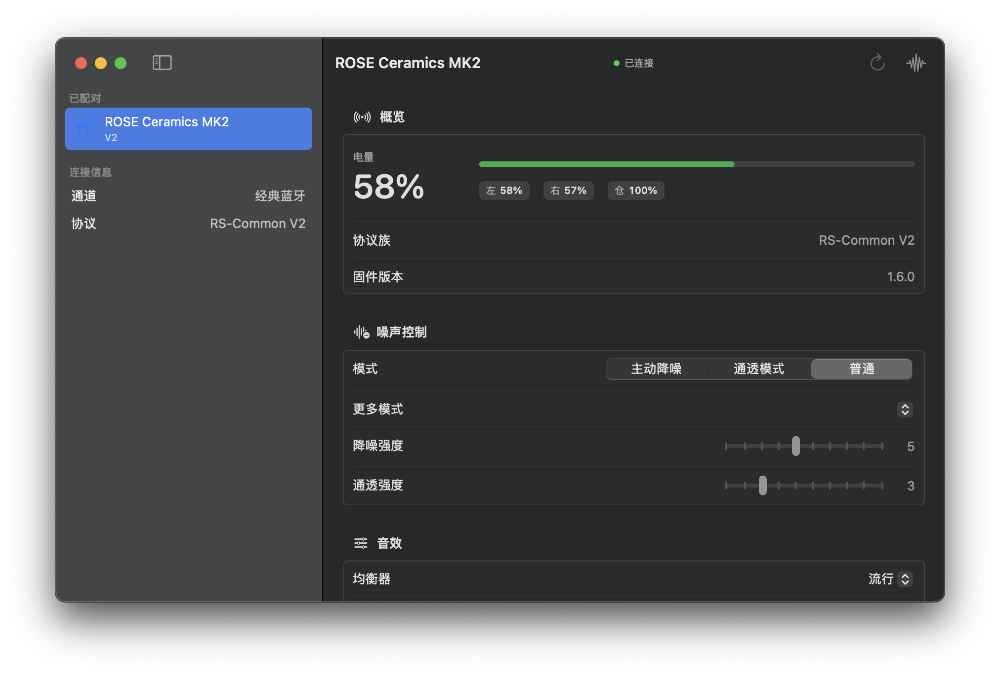
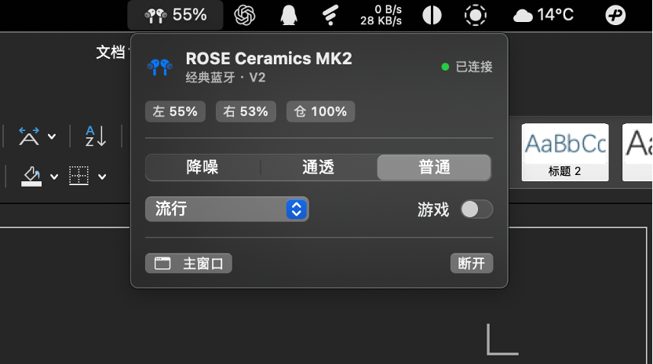

# 肉丝林克 麦金塔版

**非官方、仅供互操作研究、与 ROSESELSA 、弱水时砂科技有限公司无关**

**本程序不做任何担保**

## 说明

在 macOS 上优雅地控制你的弱水时砂耳机

目前已验证型号：ROSE Ceramic MK 2

系统最低要求：macOS 13.0 Ventura

已实现功能：电量监控 噪声控制 音效管理 设备行为 查找耳机 ~~棍母探测~~

## 软件截图

## 鸣谢

DeepSeek：编程